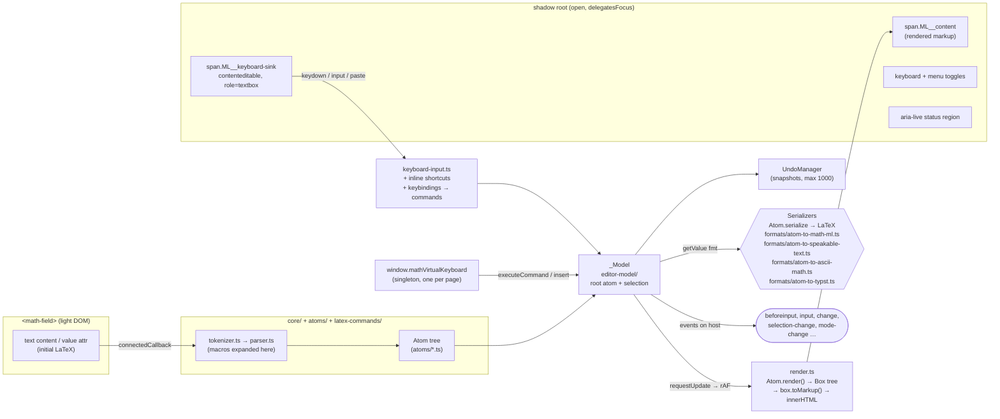

# How `<math-field>` works

MathLive **0.111.1** (released 2026-10-09; the release commit is `30ad20a7` in [arnog/mathlive](https://github.com/arnog/mathlive)). Every claim below points to either a test or script in `sandbox/basic` or a file in the MathLive source at that commit. Source paths are relative to the repo's `src/`.

> **Version note.** 0.111.0 (2026-09-30) contained breaking changes that much online material predates. The Compute Engine is no longer a dependency, the `"math-json"` output format and `mf.expression` were removed, and the host element's role changed from `math` to `group`. Treat anything older than October 2026 with care.

## 1. The big picture

In one sentence: **LaTeX is parsed into a tree of `Atom`s, the model edits that tree and tracks the selection, and every output (the on-screen HTML, LaTeX, MathML, speech) is generated from the tree.** Nothing is ever parsed from MathML or from the rendered HTML.

### 1.1 Component layers

| Layer | Source | Responsibility |
|---|---|---|
| Custom element | `public/mathfield-element.ts` | `MathfieldElement` class. Owns the lifecycle, attributes and properties, and the stash of options/value while disconnected (`gDeferredState` WeakMap). Defines `math-field` when the module loads. |
| Editor | `editor-mathfield/mathfield-private.ts` (`_Mathfield`) | Builds the shadow DOM, wires listeners, handles focus/blur, dispatches events, and talks to the virtual keyboard. |
| Model | `editor-model/model-private.ts` (`_Model`) | Holds the root atom and the selection (offsets into a flattened atom list), plus insert, delete and move commands. Notifies through `contentWillChange` / `contentDidChange` / `selectionDidChange`. |
| Parser | `core/tokenizer.ts`, `core/parser.ts` | LaTeX string → tokens → atoms. Macros are expanded during tokenizing/parsing. Errors are collected (`mf.errors`), not thrown. |
| Command definitions | `latex-commands/*.ts` | Which LaTeX commands exist (`definitions.ts`, `symbols.ts`, `environments.ts`, `mhchem.ts` …), and how each maps to an atom. |
| Atoms | `atoms/*.ts`, `core/atom-class.ts` | One class per layout primitive (genfrac, surd, subsup, array, leftright, chem, prompt, placeholder …). Each has `render()` → `Box` and `serialize()` → LaTeX. |
| Layout | `core/box.ts`, `core/v-box.ts`, `core/font-metrics*.ts` | A TeX-style box model with KaTeX font metrics. `Box.toMarkup()` writes HTML spans with **inline `style` heights and offsets**, which matters for CSP (§5.3). |
| Modes | `editor-mathfield/mode-editor-{math,text,latex}.ts` | Three input modes. Typing `\` switches to `latex` mode, where you type a command name and accept it with Enter/Escape. Each mode has its own copy/paste rules. |
| Keyboard input | `editor-mathfield/keyboard-input.ts`, `editor/keybindings*.ts`, `editor/shortcuts*.ts` | Keystroke → keybinding → command selector. Printable text goes through the inline-shortcut buffer (`pi` → `\pi`). |
| Virtual keyboard | `virtual-keyboard/*.ts` | `VirtualKeyboard` singleton in the top window, or `VirtualKeyboardProxy` in iframes, which talks to the top window over `postMessage` (`global.ts`). |
| Static rendering | `public/mathlive-ssr.ts`, `addons/static-render.ts` | `convertLatexToMarkup`, `convertLatexToMathMl`, `renderMathInElement`, and the `<math-span>` / `<math-div>` elements. |

### 1.2 Lifecycle, step by step

From `public/mathfield-element.ts` (constructor at l. 1263, `connectedCallback` l. 1966, `disconnectedCallback` l. 2099):

1. **`constructor`**: `attachInternals()` sets role `group`. `attachShadow({mode:'open', delegatesFocus:true})`. Five constructable stylesheets are adopted (`core`, `mathfield`, `mathfield-element`, `ui`, `menu`). Options passed to the constructor are stashed.
2. **`connectedCallback`**:
   - adds `pointerdown`/`focus`/`blur` capture listeners on the host;
   - starts a **`MutationObserver` on the light DOM**, so any text change sets `value`;
   - sets **`contenteditable="true"`** (an NVDA/Firefox workaround) and `tabindex="0"` on the host unless they are already present;
   - reads the initial LaTeX from the `value` attribute or the slotted text;
   - creates `_Mathfield`, which parses the LaTeX, builds the model and undo manager, and writes the shadow markup with `innerHTML` through `MathfieldElement.createHTML`;
   - queues `mount` as a microtask, and calls `loadFonts()`.
3. **Rendering** is always deferred: `requestUpdate()` marks the field dirty and renders on the next `requestAnimationFrame` (`editor-mathfield/render.ts:21`).
4. **`disconnectedCallback`**: blurs if focused, which dispatches `change`/`blur`/`focusout` in all browsers since 0.111.0. It then saves value, selection, options and menu into `gDeferredState`, **disposes `_Mathfield` completely**, and queues `unmount`.
5. **Reconnecting** builds a brand-new `_Mathfield` from the saved state (`lifecycle.test.ts`: "is torn down on disconnect…").

### 1.3 The keyboard sink

The focusable element is not the host but a hidden `span[part=keyboard-sink]` inside the shadow root. It is `contenteditable`, has `role=textbox` and `inputmode=none`, and is named from the host's `aria-label`/`<label>`/`title`. Keystrokes, IME composition and clipboard events land there (`editor/keyboard.ts`, `delegateKeyboardEvents`). When the selection changes, MathLive copies the selected LaTeX into the sink, because Safari only fires cut/copy/paste when there is a DOM selection (`mathfield-private.ts:1707`).

### 1.4 The Compute Engine

The Compute Engine is optional and **not bundled**. If the page loads `@cortex-js/compute-engine` globally, MathLive picks it up as `MathfieldElement.computeEngine`. It is then used for an extra `application/json` (MathJSON) clipboard flavour, for pasting MathJSON, and for `setValue(mathJsonObject)`. We don't need it for QTI, and nothing in this sandbox loads it.

## 2. Public API we'll use

All of these are checked against `node_modules/mathlive/types/*.d.ts` for 0.111.1.

### 2.1 Value and serialisation

| API | Notes |
|---|---|
| `mf.value` (get/set) | LaTeX. Setting it is **silent**, so no `input` fires (`events.test.ts`). |
| `mf.getValue(format?)` | Formats: `latex`, `latex-expanded` (macros expanded), `latex-unstyled`, `latex-without-placeholders`, `math-ml`, `ascii-math`, `typst`, `plain-text`, `spoken`, `spoken-text`, `spoken-ssml`, `spoken-ssml-with-highlighting` (`types/core-types.d.ts`). `math-json` was **removed** in 0.111.0. |
| `mf.getValue(start, end, fmt)` / `(range, fmt)` / `(selection, fmt)` | Serialise only part of the content. |
| `getValue('math-ml')` | Returns a **fragment with no `<math>` wrapper**. Before the element is connected it returns `''` (`lifecycle.test.ts`). See [`findings/roundtrip.md`](../findings/roundtrip.md) for the defects. |
| `mf.setValue(latex, options?)` | The default options are `{ silenceNotifications: true, mode: 'math' }`, **but passing any options object replaces that default**, so `setValue(x, {mode:'math'})` *does* fire `input` (`lifecycle.test.ts`, source l. 1754). |
| `mf.insert(latex, options?)` | Inserts at the selection. **Fires `beforeinput`/`input`**, unlike `setValue`. Options: `insertionMode` (`replaceSelection`, `replaceAll`, `insertBefore`, `insertAfter`), `selectionMode` (`placeholder`, `after`, `before`, `item`), `format`, `focus`, `feedback`, `scrollIntoView`, `silenceNotifications`. Templates use `#?` or `\placeholder{}` slots, and the first one is selected by default. |
| `mf.executeCommand(selector, …args)` | Selectors from `types/commands.d.ts`, e.g. `'undo'`, `'moveToNextPlaceholder'`, `['insert', '\\frac{#?}{#?}']`, `['switchMode', 'text']`, `'commit'` (= Enter). |
| `mf.errors` | Parse errors as `{code, arg, latex}`. The parser is lenient: `validateLatex('\\frac{a}')` reports no error. |

### 2.2 Selection

`mf.selection` (ranges + direction), `mf.position`, `mf.selectionIsCollapsed`, `mf.lastOffset`, `mf.select()`, `mf.getOffsetFromPoint(x, y)`, `mf.getElementInfo(offset)`. Offsets index a flattened list of atoms, not characters.

### 2.3 Configuration (per field)

`readOnly` / `readonly` attribute, `disabled`, `placeholder` (shown when empty), `defaultMode` (`math` \| `inline-math` \| `text`), `smartFence`, `smartMode`, `smartSuperscript`, `scriptDepth`, `removeExtraneousParentheses`, `letterShapeStyle`, `macros`, `inlineShortcuts`, `inlineShortcutTimeout`, `keybindings`, `menuItems`, `popoverPolicy`, `environmentPopoverPolicy`, `mathVirtualKeyboardPolicy` (`auto` \| `manual` \| `sandboxed`), `placeholderSymbol`, `onInlineShortcut`, `onExport`, `onInsertStyle`, `onScrollIntoView`.

- **`macros`**: `{ name: 'expansion with #1' }` or `{ name: { def, args, captureSelection, expand } }`. `getValue('latex')` keeps the macro name, while `latex-expanded` inlines it. **Custom macros vanish from `getValue('math-ml')`.** Generate MathML from `latex-expanded` instead (`lifecycle.test.ts`). **Important for storage:** a stored LaTeX annotation that uses a custom macro needs the same macro definitions when it is loaded again, so store `latex-expanded` unless the macro set is versioned with the content.
- **`inlineShortcuts`**: `{ trigger: 'latex' }` or `{ trigger: { value, after } }`, where `after` limits the context, e.g. `'digit'`. Our test confirms that typing `pi` gives `\pi`.
- **Prompts (fill-in-the-blank):** `\placeholder[id]{}` plus `readOnly` turns the field into a form with editable slots. Use `getPromptValue(id)`, `setPromptValue`, `getPrompts()` and `setPromptState(id, 'correct'|'incorrect', locked)`. This maps closely onto QTI text-entry interactions and is worth a look in M3.

### 2.4 Global (static) configuration

These are static, on `MathfieldElement`: `fontsDirectory`, `soundsDirectory`, `keypressSound`, `plonkSound`, `keypressVibration`, `locale`, `strings`, `decimalSeparator`, `fractionNavigationOrder`, `createHTML` (Trusted Types hook), `speechEngine`, `textToSpeechRules` (`mathlive` \| `sre`), `textToSpeechMarkup`, `computeEngine`, `isFunction`, `restoreFocusWhenDocumentFocused`.

### 2.5 Virtual keyboard

`window.mathVirtualKeyboard` is one shared instance per page. API: `show()`, `hide()`, `visible`, `layouts`, `alphabeticLayout`, `editToolbar`, `container`, `boundingRect`, plus events `before-virtual-keyboard-toggle`, `virtual-keyboard-toggle` and `geometrychange`. Its DOM is created lazily on the first `show()` and appended to `container` (default `document.body`, whose `padding-bottom` it adjusts).

## 3. Events

Measured in Chromium with Playwright's real keyboard (`tests/events.test.ts`, 14 tests; raw log in [`findings/events-raw.json`](../findings/events-raw.json)). `keydown` is left out of the sequences unless it matters.

| Trigger | Events, in order |
|---|---|
| Element connected | `mount` (microtask, *after* `append()` returns) |
| `mf.value = …`, `mf.setValue(…)` | **none** |
| `mf.setValue(…, {any options})` | `input` |
| `mf.insert(…)` | `beforeinput` → `selection-change` → `undo-state-change` → `input` |
| Type a character | `beforeinput` → `selection-change` → `undo-state-change` → `input` (`input` is deferred with `setTimeout(0)`, `model-private.ts:862`) |
| Arrow keys | `selection-change` (then the host sees `keydown`) |
| Arrow past the start/end | `move-out` `{direction:'backward'|'forward'}` |
| Enter / `executeCommand('commit')` | `beforeinput(insertLineBreak)` → **`change`** → `input(insertLineBreak)`. `change` fires even when nothing changed. |
| Type `\` | `mode-change` (to `latex`) → `selection-change` → `input` |
| Undo | `beforeinput(historyUndo)` → `selection-change` → `undo-state-change {type:'undo'}` → `input` |
| Focus | `focus` → `focusin`, ~60 ms after the call (see gotchas) |
| Blur after an edit | `change` → `blur` → `focusout` |
| Blur without an edit | `blur` → `focusout` |
| Virtual keyboard `show()` / `hide()` | on the keyboard: `before-virtual-keyboard-toggle {visible}` → `virtual-keyboard-toggle`. **On the field: `blur` → `focusout` → `focus` → `focusin`.** |
| Removed while focused | `blur` → `focusout` → `unmount` (+ `change` first if edited) |

`beforeinput` is cancelable and lets you veto an edit. `mode-change` is cancelable too.

## 4. Rendering, fonts and static output

- **Fonts:** 20 KaTeX woff2 files, 254 KB in total. Only the faces actually used are downloaded (2 for the demo formula). By default MathLive loads them with the `FontFace` API from `fontsDirectory` (`'./fonts/'`), **resolved relative to MathLive's own script URL**. To find that URL it parses a stack trace (`common/script-url.ts`) and then sends a `HEAD` request to it.
- **Static output:** `convertLatexToMarkup()` gives the same HTML the field renders. It needs `mathlive-static.css` and the fonts. `convertLatexToMathMl()` gives the same MathML fragment as `getValue('math-ml')`.
- **Many equations** (`scripts/runtime-check.mjs`, Chromium, time from first creation until 2 frames later):

  | Count | `<math-field read-only>` | `convertLatexToMarkup` into spans | native MathML |
  |---|---|---|---|
  | 200 | 901 ms | 219 ms | 111 ms |
  | 1000 | **11 369 ms** | 797 ms | 379 ms |

  Read-only fields scale super-linearly (×5 count gave ×12.6 time). Each one has its own shadow root, sink, listeners and `ResizeObserver`. This is the strongest data point so far for Froala embedding strategy (b): store static output, and only open a live `<math-field>` while editing. See the gotchas.

## 5. Bundle, CSP, Trusted Types, SSR

### 5.1 Bundle size (`pnpm size`, Vite 8 production build)

| Import | Minified | gzip | brotli |
|---|---|---|---|
| `import 'mathlive'` (element + keyboard) | 782 KB | 213 KB | 173 KB |
| `import { convertLatexToMathMl } from 'mathlive'` | 782 KB | 213 KB | 174 KB |
| `import { convertLatexToMathMl } from 'mathlive/ssr'` | 335 KB | 97 KB | 81 KB |
| `mathml-to-latex` (our converter for annotation-less MathML) | 168 KB | 51 KB | 41 KB |

The `mathlive` entry **does not tree-shake**. Importing one converter costs the whole editor, because the module has side effects: it defines the element and mounts the keyboard. Use `mathlive/ssr` for render-only code paths, which works in the browser too. Plus fonts (only what's used, out of 254 KB), plus sounds (244 KB, optional; set `soundsDirectory = null`).

### 5.2 Fonts with a bundler

With Vite, the default font loading **fails**. Every font 404s at `/assets/fonts/…` (recorded in [`findings/runtime-check-before-fontfix.json`](../findings/runtime-check-before-fontfix.json)). Setting `MathfieldElement.fontsDirectory` in your entry module is **too late** when a `<math-field>` is already in the HTML. The element upgrades and calls `loadFonts()` *while the `import 'mathlive'` statement is evaluated*, and `loadFonts()` reads `fontsDirectory` synchronously (`core/fonts.ts:65`).

**What works** (used in `src/main.ts`): `import 'mathlive/fonts.css'`. Vite rewrites the `url(fonts/…)` references into hashed assets, and the stylesheet sets `--ML__static-fonts`, which makes MathLive skip its own loader. Also set `build.assetsInlineLimit: 0`, otherwise Vite inlines `KaTeX_Size3` as a `data:` URI, which a `font-src 'self'` CSP blocks. Angular's builder should behave the same way; that gets verified in M2.

### 5.3 Content-Security-Policy (`scripts/runtime-check.mjs`, screenshots in `findings/screenshots/`)

| Policy | Result |
|---|---|
| `default-src 'self'; script-src 'self'; style-src 'self'; font-src 'self'; connect-src 'self'` | **Broken layout.** `style-src-attr` violations: MathLive's markup sets heights and offsets with `style="…"` attributes. The fraction collapses (`strict-csp.png`). |
| Same + `style-src-attr 'unsafe-inline'` | **Works.** `style-src-elem` can stay strict, because the component styles are constructable stylesheets, which CSP doesn't govern. |
| + `require-trusted-types-for 'script'`, no policy | **Blocked.** The field never renders (`innerHTML` sink). |
| + `trusted-types mathlive` and `MathfieldElement.createHTML = policy.createHTML` set *before the first field connects* (`src/trusted-types.ts`) | **Works.** |

No `unsafe-eval` is needed: there is no `eval`/`new Function` in the source. With the default dynamic font loader, `connect-src` must allow the HEAD request to the script URL; the static fonts.css approach avoids it. **No network requests leave the origin**, so it is suitable for air-gapped use.

### 5.4 SSR / hydration (`pnpm ssr-check`, output in [`findings/ssr-check.txt`](../findings/ssr-check.txt))

- Under Node, `import 'mathlive'` resolves (through the `node` export condition) to the **SSR build**. It exports only `convertLatexToMarkup`, `convertLatexToMathMl`, `convertLatexToAsciiMath`, `convertAsciiMathToLatex`, `convertLatexToSpeakableText` and `validateLatex`. **`MathfieldElement` is undefined on the server.** Angular SSR code must not touch it outside `isPlatformBrowser`/`afterNextRender`.
- `convertLatexToSpeakableText` **throws in Node** (`TypeError: … reading 'textToSpeechRules'`), because it reads a global `MathfieldElement`. A stub global works around it (shown in the script).
- There is no hydration in the Angular sense. A server-rendered `<math-field>` is just its LaTeX text until the client upgrades it, so readers see raw LaTeX at first. If that matters, render static markup or MathML on the server and swap in the field on the client.

## 6. Gotchas

1. **`getValue('math-ml')` is not safe to store as-is.** It can give malformed XML (`&ne;`, `&nbsp;`, a typo with stray quotes on prompts), can produce nothing for `\ce{}` and `\overline`, drops bodies of `\overrightarrow`/`\underbrace`, and **drops user-defined macros entirely**. Validate or post-process it, or use another converter for storage. The full list is in [`findings/roundtrip.md`](../findings/roundtrip.md).
2. **MathLive cannot read MathML.** There is no MathML parser. Keeping LaTeX next to the MathML (annotation or `data-latex`) is required for editing. Annotation-less content (e.g. from Wiris) needs a converter (`mathml-to-latex`), and that conversion loses detail.
3. **Programmatic changes are inconsistent about events.** `value=` and `setValue()` are silent; `setValue(v, {…})` and `insert()` are not.
4. **`focus()` is asynchronous (~60 ms).** If the field loses focus during that window, the blur is swallowed with no `blur` event (`events.test.ts`). Code that focuses and then immediately types or checks `hasFocus()` will be flaky.
5. **Showing or hiding the virtual keyboard blurs and refocuses the field.** Anything listening for `blur` (Froala closes popups and saves on blur) will see spurious blurs.
6. **For command keys (Enter, arrows), `keydown` reaches host listeners after MathLive has acted.** To intercept, use a **capture-phase** listener on the host (`events.test.ts`). Printable keys are handled later, via the sink's `input` event.
7. **The host gets `contenteditable="true"`** unless `user-select: none` is set. Nested inside Froala's own `contenteditable`, this matters for caret handling, selection and Froala's DOM cleanup. M2 needs to set `user-select:none` or `contenteditable="false"` on the island and re-test.
8. **Moving the element in the DOM destroys and rebuilds the editor.** Froala re-parenting nodes (undo snapshots, `html.set`) costs a full re-init each time. The value and options survive; listeners on internal parts and the undo history do not.
9. **The light DOM is observed.** Rewriting the element's `textContent`, as a sanitizer or an editor's HTML normaliser might, silently replaces the value.
10. **Fonts and Trusted Types must be configured before the first field connects.** In practice that means the static fonts.css, and `createHTML` set in a module that runs before any `<math-field>` exists.
11. **A strict CSP needs `style-src-attr 'unsafe-inline'`.**
12. **`import from 'mathlive'` is all-or-nothing** (782 KB min). Use `mathlive/ssr` for converters.
13. **There is one virtual keyboard per page**, in the top window. Inside an iframe you get a proxy that `postMessage`s the top window, unless `mathVirtualKeyboardPolicy = 'sandboxed'` is set.
14. **Copying gives `text/plain`, `application/x-latex` and `application/json+mathlive`, but no MathML or HTML.** Pasting a copied formula into Froala gives raw LaTeX text unless the plugin handles it.
15. **Speech output has gaps** (empty for `\boxed`, `aligned`, `\ce`; truncated `cases`; `≠` missing). This counts against the accessibility requirement and needs a screen-reader pass (NVDA/VoiceOver) in M4. `textToSpeechRules = 'sre'` (Speech Rule Engine) is an alternative to test.
16. **Many read-only fields are slow** (1000 fields ≈ 11 s). Don't use live fields to *display* math in long documents.

## 7. Debugging from source

- Clone `arnog/mathlive` and check out `30ad20a7`. There is no `v0.111.1` tag on GitHub; the commit named "0.111.1" is the release.
- The npm package ships an unminified `mathlive.mjs`, which the `development` export condition selects. Vite's dev server uses that condition, so you can step through readable code in devtools with `pnpm dev`. Production builds pick `mathlive.min.mjs`.
- Useful entry points: `_Mathfield` constructor (shadow markup), `onFocus`/`onBlur` (focus quirks), `_Model.contentDidChange` (the `input` event), `render.ts` (render loop), `formats/atom-to-math-ml.ts` (MathML output), `core/parser.ts` `parseLatex()`.
- In the sandbox, `window.mf` is the demo field, the page shows LaTeX, MathML (with a well-formedness check), speech, ASCIIMath and the browser's own MathML rendering, and it logs events live (`pnpm dev`).
