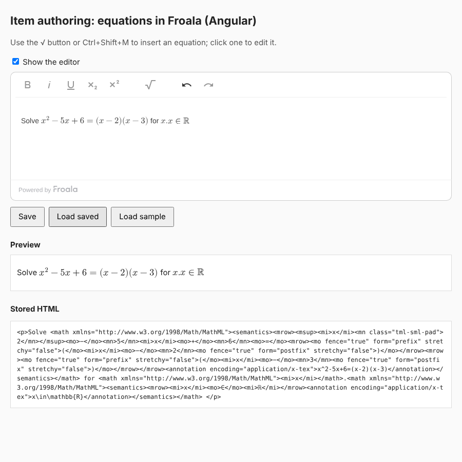
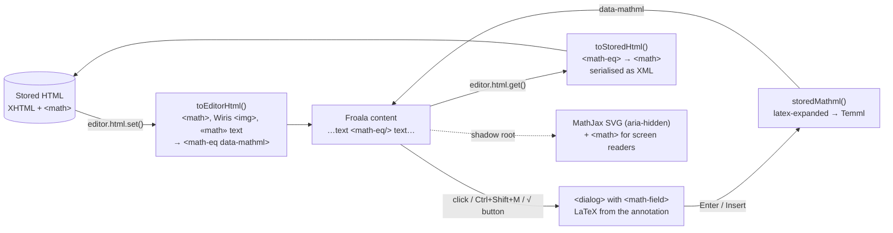

# Equations in Froala

Froala Editor **5.5.0**, angular-froala-wysiwyg **5.5.0**, Angular **22.2.3**, MathLive **0.111.1**. Every claim below points to a test or script in [`sandbox/froala`](../sandbox/froala) or [`apps/authoring`](../apps/authoring).

**Result.** An author can insert, edit, save and reload equations in Froala, inside an Angular 22 app, with no data loss in the tested cases. The content holds rendered equations and a popup `<math-field>` edits them (strategy **(b)**). What gets saved is XHTML with plain MathML, so it can go into a QTI item body as is. Existing Wiris content loads and becomes editable.

| | Where |
|---|---|
| Froala plugin | [`sandbox/froala/src/froala-math-plugin.ts`](../sandbox/froala/src/froala-math-plugin.ts) |
| Equation element (display) | [`sandbox/froala/src/math-eq-element.ts`](../sandbox/froala/src/math-eq-element.ts) |
| Popup editor | [`sandbox/froala/src/equation-dialog.ts`](../sandbox/froala/src/equation-dialog.ts) |
| Stored ↔ editor HTML, Wiris import | [`math-html.ts`](../sandbox/froala/src/math-html.ts), [`wiris.ts`](../sandbox/froala/src/wiris.ts), [`mathml-allowlist.ts`](../sandbox/froala/src/mathml-allowlist.ts) |
| Angular component | [`apps/authoring/src/app/math-froala-editor.ts`](../apps/authoring/src/app/math-froala-editor.ts) |
| Tests (Chromium) | 96 in [`sandbox/froala/tests`](../sandbox/froala/tests): HTML in/out for all 60 corpus formulas, Wiris formats, editing, undo, keys, paste, teardown |
| Browser checks | [`sandbox/froala/scripts/demo-check.mjs`](../sandbox/froala/scripts/demo-check.mjs) → [`findings/froala-demo-check.json`](../findings/froala-demo-check.json); [`apps/authoring/scripts/check.mjs`](../apps/authoring/scripts/check.mjs) → [`findings/angular-check.json`](../findings/angular-check.json) |



## 1. How it works



Three formats, each with one job:

| Format | Example | Who uses it |
|---|---|---|
| **Stored** | `<p>Solve <math xmlns="…MathML"><semantics><mrow>…</mrow><annotation encoding="application/x-tex">x^2-5x+6=0</annotation></semantics></math>.</p>` | The database and the QTI item body. Plain MathML, no wrappers. The LaTeX annotation is what makes it editable again ([M1 finding](../findings/roundtrip.md): MathLive can't read MathML). |
| **Editor** | `<math-eq data-mathml="&lt;math …" contenteditable="false" class="fr-deletable"></math-eq>` | Froala's content while editing. One empty element per equation; the MathML sits in an attribute. |
| **Display** | the shadow root of `<math-eq>`: MathJax SVG + visually hidden `<math>` | What the author sees. The same SVG as print ([consistency.md](../findings/consistency.md)), same code as the [insert demo](../findings/insert-demo.md). |

Why an empty custom element with a shadow root, rather than the SVG in the content:

- **Froala never sees MathML or SVG while editing.** Its cleaning, space normalising and undo snapshots only see one attribute. Its default allow-list strips SVG, and it changes MathML text (§4, gotchas 1 and 3).
- **Undo is cheap.** Undo restores `innerHTML`; the element re-renders from a cache keyed by MathML. 100 equations re-render in ~50 ms (§5).
- **Saving is trivial.** `html.get()` replaces each element with its attribute. The SVG is never stored.

## 2. Using it

```ts
import FroalaEditor from 'froala-editor';
import 'mathlive/fonts.css'; // or angular.json "styles"
import { COMMAND, registerMathPlugin, withMathOptions } from '@sandbox/froala';

registerMathPlugin(FroalaEditor); // once, before creating editors
new FroalaEditor('#editor', withMathOptions({ toolbarButtons: ['bold', COMMAND, 'undo', 'redo'] }, FroalaEditor.DEFAULTS));
editor.html.set(storedHtml);         // stored → editor, Wiris content included
const toSave = editor.html.get();    // editor → stored XHTML
```

- **Insert**: the √ toolbar button or **Ctrl/Cmd+Shift+M** opens the dialog at the caret.
- **Edit**: click an equation (or select it and press Ctrl+Shift+M). While its dialog is open it is outlined, via a custom element state (`:state(editing)`), so the highlight never reaches the HTML or the undo stack.
- **In the dialog**: Enter inserts or updates, Escape cancels. Inside a LaTeX command (after typing `\`), both keys go to MathLive, as it needs them to finish the command. An empty field or LaTeX that Temml rejects keeps the dialog open with a message.
- `withMathOptions()` merges the MathML allow-list into the options. The plugin adds the same lists when it starts, but Froala cleans the element's initial content before any plugin runs (gotcha 2).

Froala hooks the plugin uses: `html.set` (wrapped, so stored HTML is converted before Froala's cleaning), the `html.get` chained event (returns the stored form), `paste.after` (hydrates pasted MathML or Wiris images), and `destroy` (removes the dialog and listeners). It follows the pattern of Wiris's own Froala plugin, which also swaps formats in `html.get`/`html.set` (`@wiris/mathtype-froala` 8.15.4, `wiris.src.js`).

## 3. The equation as an atomic island

Driven with real key presses and clicks (Playwright), in [`tests/editing.test.ts`](../sandbox/froala/tests/editing.test.ts):

| Behaviour | Result | How |
|---|---|---|
| Arrow keys | ✅ one press steps over the equation, both ways | `contenteditable="false"` |
| Typing next to it | ✅ never goes inside | same |
| Backspace after it | ✅ removes it whole; undo restores it | Froala's `fr-deletable` class |
| Delete before it | ✅ removes it whole; undo restores it | **plugin**: Froala 5.5.0 ignores `fr-deletable` on forward Delete (gotcha 4) |
| Select across + type | ✅ replaced like any text | browser |
| Copy / paste inside the editor | ✅ the copy is a second editable equation | Ctrl+C / Ctrl+V; the clipboard carries `<math-eq data-mathml>` |
| Paste MathML from another page | ✅ becomes an editable equation | allow-list + `paste.after` |
| Paste a Wiris formula image | ✅ becomes an editable equation | same |
| Undo / redo of insert and edit | ✅ | the plugin saves one undo step per change |
| Open and cancel the dialog | ✅ no change to HTML or undo stack | custom state, not a class |
| Insert at the caret, caret after | ✅ no caret markers left behind | `selection.save()/restore()` around the dialog |

## 4. Saved HTML and Froala's sanitizer

- **Default Froala destroys MathML.** `<math>` isn't in `htmlAllowedTags`, so Froala unwraps it and keeps the text: `a+b^2` plus its annotation turns into the visible text `a+b2a+b^2` ([`html-in-out.test.ts`](../sandbox/froala/tests/html-in-out.test.ts), "without the plugin"). The plugin adds 44 MathML elements, 69 MathML attributes and `math-eq` to the allow-lists ([`mathml-allowlist.ts`](../sandbox/froala/src/mathml-allowlist.ts)). Froala 5.5.0 only uses DOMPurify when `window.DOMPurify` is present; it isn't here.
- **Round trip.** For all 60 corpus formulas, `html.set(stored)` then `html.get()` gives back the same XML. The only byte difference is `<mspace></mspace>` (Temml) vs `<mspace/>` (XML serialiser).
- **Well-formed XML.** `html.get()` serialises as XML: Froala's `&nbsp;` becomes U+00A0 and `<br>` becomes `<br />`, both of which a QTI item body needs. The result still parses the same as HTML.
- **Stable after one save.** Froala turns a U+00A0 typed after an inline element into a plain space on load, with or without equations. After that first save → load, the HTML is byte-stable ([demo check](../findings/froala-demo-check.json): `secondReloadIdentical: true`).
- **Broken equations aren't saved.** A `math-eq` whose MathML doesn't parse is dropped rather than stored as junk.

## 5. Strategy (a) vs (b)

Measured with 100 equations (60 distinct) in one editor ([`tests/strategy-a.test.ts`](../sandbox/froala/tests/strategy-a.test.ts) → [`findings/froala-strategies.json`](../findings/froala-strategies.json)):

| | (a) inline `<math-field read-only>` | (b) `<math-eq>` + popup (built) |
|---|---|---|
| Load 100 equations, first time | 449 ms | 191 ms (fonts + MathJax render of 60 distinct) |
| Load again / reopen item | 451 ms | 39 ms (render cache) |
| Undo with 100 equations | 415 ms | 47 ms |
| Undo snapshot size | 12.8 KB (LaTeX) | 58.1 KB (MathML in attributes) |
| What screen shows | MathLive's HTML/CSS rendering | **the same MathJax SVG as print** |
| Saved format | LaTeX in the element; needs its own LaTeX → MathML step on save and MathML → LaTeX on load | `html.get()` returns the stored MathML |
| Screen reader | MathLive's own spoken text per field | the stored MathML (what the QTI player will have) |
| Edit in place | ✅ (needs extra code: a read-only field can't be typed in) | ❌ popup |
| One `MathfieldElement` per equation | yes (M1: 1000 fields ≈ 11 s to mount) | one for the whole page |
| Caret, Backspace | ✅ same as (b) when `contenteditable="false"` is set | ✅ |

**Decision: (b).** The evidence isn't split: (b) is ~10× faster to load and undo, it keeps screen and print identical (the M1 consistency requirement), and the screen reader reads the stored MathML. (a)'s one advantage, editing in place, doesn't outweigh that for an authoring tool where equations are edited far less often than they're displayed.

**What would change it**: if authors need to edit long expressions in place without a popup (for example, inline answer blanks), or if the popup proves awkward on touch devices in M3 testing.

## 6. Existing Wiris content

Read from Wiris's own source (`@wiris/mathtype-html-integration-devkit` 1.17.17, `@wiris/mathtype-froala` 8.15.4); tested in [`tests/wiris.test.ts`](../sandbox/froala/tests/wiris.test.ts):

| Wiris stores | Example | Handled |
|---|---|---|
| `saveMode: 'xml'` | `<math xmlns="…">…</math>` | ✅ plain MathML |
| a formula typed as LaTeX | `<annotation encoding="LaTeX">x^2</annotation>` | ✅ the LaTeX is used for editing as is |
| the editor `` / `saveMode: 'image'` | `` | ✅ the MathML in `data-mathml` |
| `saveMode: 'safeXml'` | text `«math xmlns=¨…¨»…«/math»` | ✅ |
| handwriting | `<annotation encoding="application/json">` strokes | ✅ dropped, as Wiris does on save |

- **Unedited Wiris equations are kept byte for byte** (as XML), so loading and saving an item changes nothing.
- **Editing one** needs LaTeX. Without a LaTeX annotation it's converted from MathML (`mathml-to-latex`, from M1), and the dialog warns: "Its LaTeX was converted from MathML, so check it before you save." Once updated it's stored as our format.
- Wiris's `$$…$$` LaTeX parse mode isn't handled.
- **The samples are built from Wiris's source, not from our database.** A handful of real Wiris-authored items would close this.

## 7. Angular

[`MathFroalaEditor`](../apps/authoring/src/app/math-froala-editor.ts) wraps `angular-froala-wysiwyg`'s directive:

```html
<app-math-froala-editor [(value)]="stem" />   <!-- stem: the stored XHTML -->
```

- `value` is two-way. Froala's `contentChanged` (which the plugin triggers on insert and edit) updates it; setting it from outside loads new content.
- [`StoredHtmlPreview`](../apps/authoring/src/app/stored-html-preview.ts) shows stored HTML the way a candidate sees it (same `<math-eq>` rendering, read-only).
- **Teardown** ([`check.mjs`](../apps/authoring/scripts/check.mjs)): 20 unmount/mount cycles, half of them with the dialog open, leave no listeners on window/document/body, no dialogs and no orphan editors. The virtual keyboard is back in `<body>`. Unmounting in the same task as mounting left no orphan editor either. The same check with plain Froala in [`tests/teardown.test.ts`](../sandbox/froala/tests/teardown.test.ts).
- **Size**: the initial bundle is 3.42 MB raw, 794 kB estimated transfer (Froala, MathLive, Temml, MathJax and its font). MathJax's rarer font ranges are already lazy chunks. Loading MathLive and Temml only when the dialog first opens is the obvious next step; it isn't done yet.

## 8. Gotchas

1. **Froala strips MathML by default** and leaves its text, annotation included, as visible text. Fix: the allow-list.
2. **Froala cleans the element's initial content before plugins start**, so MathML already in the element is lost unless the allow-list is in the options: use `withMathOptions()`.
3. **Froala collapses runs of spaces in MathML text** when it cleans HTML, for example in a LaTeX annotation (`\\  &` → `\\ &`). The plugin wraps `html.set()` so stored HTML is converted before Froala cleans it.
4. **Delete (forward) doesn't remove an `fr-deletable` element** in Froala 5.5.0; Backspace does. The plugin handles Delete, in the capture phase on the wrapper, because Froala's own handler would otherwise also delete the next character.
5. **Froala saves the undo step for a Backspace on a timer** after the key, not at once. An undo issued within about half a second of the key can go one step too far back. Tests wait for it.
6. **A modal `<dialog>` makes the virtual keyboard inert**, because it lives in `<body>`. The dialog moves it in with `mathVirtualKeyboard.container`.
7. **Outside `<body>`, MathLive sizes the keyboard to its container** (`.ML__keyboard { position: relative; height: 100% }`), so in a plain container it has zero height. The container is a fixed, full-viewport, click-through layer inside the dialog, and the dialog moves up by the keyboard's height (`geometrychange`).
8. **Inside an iframe, `mathVirtualKeyboard` is a proxy to the top window's keyboard**, and setting its container throws "Container inside an iframe cannot be changed". The dialog catches that and leaves the keyboard where it is. If the authoring tool runs in an iframe, the keyboard needs `math-virtual-keyboard-policy="sandboxed"` or MathLive in the top window. Not tested further. (Vitest runs tests in an iframe, so the keyboard is checked in `demo-check.mjs` instead.)
9. **MathLive binds Escape** (switch to LaTeX mode) **and Enter** (commit). The dialog takes both in the capture phase except in LaTeX mode.
10. **MathLive leaves three one-shot listeners** (window `blur`, document `focusin` and `click`) each time a field loses focus, including on removal (`restoreFocusWhenDocumentFocused`). They keep the removed field alive until the next click or focus anywhere on the page. Not a lasting leak, but a leak detector sees them.
11. **MathJax 4.1.3 draws a `<math>` with several children only up to its first operator.** Wiris writes MathML without an outer `<mrow>`, so `e^{iπ}+1=0` showed as `e^{iπ}`. Same root as the `<semantics>` bug in M1. Fixed in `prepareForSvg()` (wrap in `<mrow>`), with tests in `sandbox/converters/tests/print.node.test.ts`. **This affected the print path too.**
12. **MathJax and Vite pre-bundling**: if `@mathjax/src` is pre-bundled, the on-demand font ranges get a second copy of MathJax whose loader isn't the patched one, and `\mathbb` fails. Exclude both `@mathjax/src` and the font package from `optimizeDeps` in this sandbox. The font loader now uses plain `import()` calls instead of Vite's `import.meta.glob`, so the Angular CLI (esbuild) can build it.
13. **Highlighting with a class pollutes undo**: Froala snapshots `innerHTML` on clicks, so a class added while the dialog is open becomes an undo step. Use a custom element state.
14. **angular-froala-wysiwyg creates the editor after a dynamic `import()`**, so a component destroyed in between would leave an orphan editor. The component destroys the editor as soon as it appears.
15. **angular-froala-wysiwyg overwrites `events.initialized`** in the options when the model has content, so hooks must use other events.
16. **Angular CLI 22 needs Node ≥ 22.22.3 or ≥ 24.15.0.** The container has 22.22.0; the Angular app was built with Node 24.15.0.
17. **froala-editor's typings** say event handlers return `void | boolean`; chained events such as `html.get` use the handler's string. The plugin types the editor loosely.
18. **Unlicensed Froala** shows "Powered by Froala" in the editor. No licence key was used.

## 9. Not done yet

- Real Wiris content from our database (see §6).
- Screen reader testing (NVDA, JAWS, VoiceOver) of the editor: Chromium's accessibility tree shows each equation as a `math` node with its content (`aria` in the check outputs). Planned for M4.
- Display (block) equations: everything is inline.
- Froala's code view (`html` command) and track changes plugins are not loaded or tested.
- Lazy-loading MathLive and Temml for a smaller initial bundle (§7).
- Server-side Temml conversion with guards (from the M1 security note); the dialog converts in the browser.

## Running it

```sh
pnpm install
cd sandbox/froala
pnpm dev                       # demo: load, edit, save, reload, load Wiris content
pnpm test                      # 96 tests in Chromium (set PW_CHROMIUM if Playwright's browser isn't installed)
pnpm build && pnpm demo:check  # drive the built demo, screenshots, findings/froala-demo-check.json
VITE_PROBE=1 pnpm exec vitest run tests/strategy-a.test.ts   # findings/froala-strategies.json

cd ../../apps/authoring        # needs Node ≥ 22.22.3 or 24.15
pnpm start                     # Angular demo
pnpm build && pnpm check       # drive the built app, findings/angular-check.json
```
