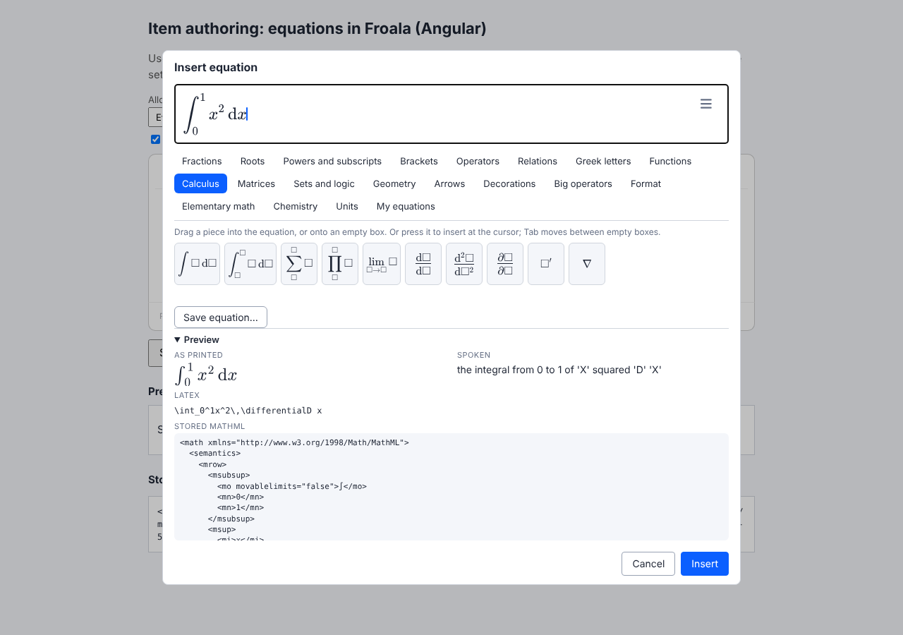
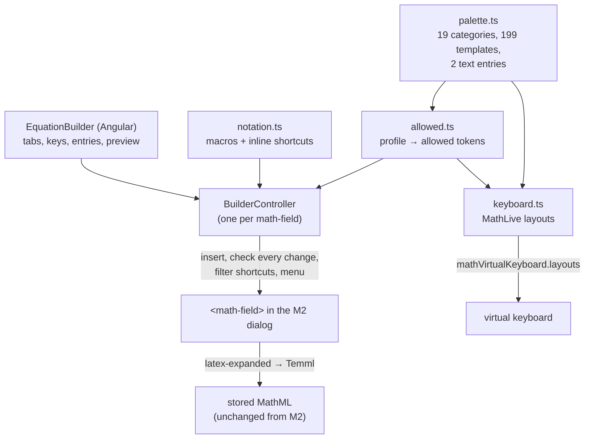
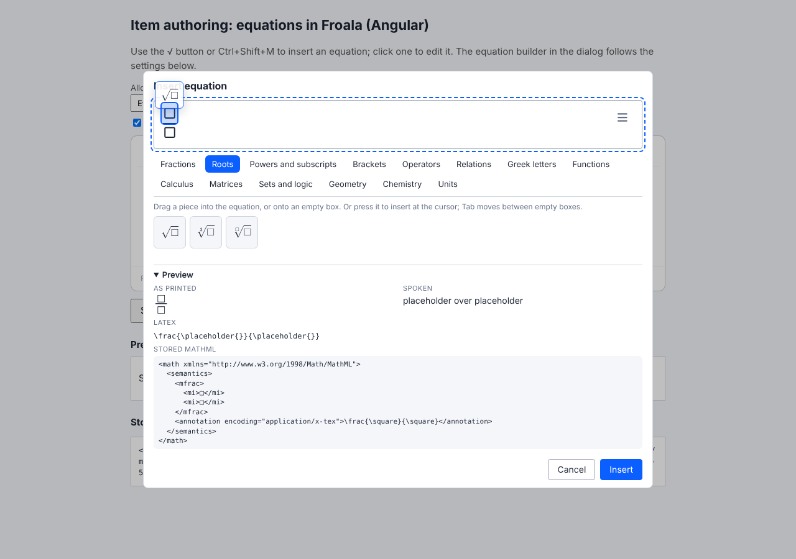
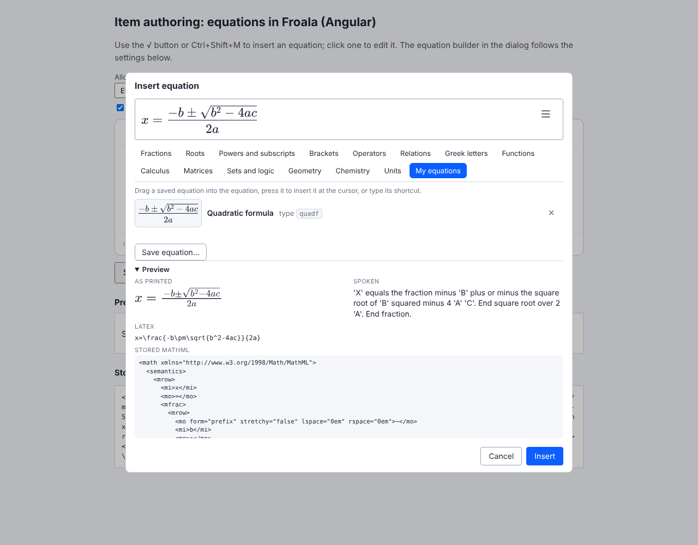

# The equation builder

MathLive **0.111.1**, Temml **0.14.0**, Angular **22.2.3**. Every claim below points to a test in [`sandbox/builder`](../sandbox/builder) or to the browser check [`apps/authoring/scripts/builder-check.mjs`](../apps/authoring/scripts/builder-check.mjs), whose output is [`findings/builder-check.json`](../findings/builder-check.json).

**Result.** The equation dialog from M2 now has a palette-driven builder under its field. Authors who don't know LaTeX pick templates from 19 categories, Tab between the empty boxes, type chemistry and units as plain text, and see the LaTeX, the stored MathML, the spoken text and the printed rendering while they type. A per-assessment profile restricts what can be entered, whichever way it arrives. Input UI decision: **the panel, with the custom virtual keyboard shown automatically on touch devices** (§5). Both are generated from one palette definition.

| | Where |
|---|---|
| Palette, profiles, notation, keyboard layouts, controller (no framework) | [`sandbox/builder/src`](../sandbox/builder/src) |
| `EquationBuilder` (Angular) | [`apps/authoring/src/app/equation-builder`](../apps/authoring/src/app/equation-builder) |
| How it plugs into the M2 dialog | `mathEquationExtend` option, [`equation-dialog.ts`](../sandbox/froala/src/equation-dialog.ts); [`math-froala-editor.ts`](../apps/authoring/src/app/math-froala-editor.ts) |
| Tests (Chromium) | 171 in `sandbox/builder/tests`; 2 more in [`sandbox/froala/tests/extension.test.ts`](../sandbox/froala/tests/extension.test.ts) |
| Browser check, comparison, screenshots | [`builder-check.mjs`](../apps/authoring/scripts/builder-check.mjs) → [`findings/builder-check.json`](../findings/builder-check.json), `findings/screenshots/builder-*.png` |



## 1. How it fits together



- **Nothing about the stored format changes.** The dialog still saves `storedMathml()`: the field's `latex-expanded` through Temml. So templates, macros and shortcuts only change how LaTeX gets *into* the field; stored items never contain our macros or MathLive-only commands (`notation.test.ts`, "our macros are expanded away").
- **The dialog got an extension point** rather than the builder replacing it. `new EquationDialog(doc, extend)`, or the Froala option `mathEquationExtend`, gets `{ dialog, field, slot }` and may return `opened()`, `validate()` (a message keeps the dialog open) and `destroy()`. Without it, the dialog is exactly as in M2 (`extension.test.ts`).
- **Angular**: `MathFroalaEditor` passes an extender that creates `EquationBuilder` in the slot with `createComponent(..., { hostElement })` and attaches it to the app; `profile` and `ui` inputs are pushed into it when they change. It is destroyed with the editor.

```html
<app-math-froala-editor [(value)]="stem" [profile]="profile" [ui]="'panel'" />
```

## 2. The palette

| Category | Examples | Notes |
|---|---|---|
| Fractions | fraction, mixed number, slash, large | `\frac{#@}{#?}`: takes the term before the caret (3x → 3x over □) |
| Roots | √, ∛, nth root | wrap the selection (`#0`) |
| Powers and subscripts | x², x³, xⁿ, xₙ, xₙᵐ, x⁻¹, eⁿ, ×10ⁿ | |
| Brackets | ( ) [ ] { } \|x\| ‖x‖ ⟨⟩ ⌊⌋ ⌈⌉ | `\left…\right`, wrap the selection |
| Operators, Relations | ± ∓ × · ÷ ∞ % ! … ≠ ≤ ≥ ≈ ≡ ∝ → ⇒ ⇔ | |
| Greek letters | 18 lower case, 9 capitals | |
| Functions | sin cos tan sin⁻¹ ln log log_b exp f(x) | |
| Calculus | ∫, ∫ₐᵇ, Σ, Π, lim, d/dx, d²/dx², ∂/∂x, ′, ∇ | |
| Matrices | 2×2, 3×3, [2×2], determinant, column vector, cases, binomial | |
| Sets and logic | ∈ ∉ ⊂ ⊆ ∪ ∩ ∅ ℕ ℤ ℚ ℝ ∀ ∃ | |
| Geometry | ∠ △ ⊥ ∥ ≅ ∼ ° segment | |
| Arrows | → ← ↔ ↑ ↓ ⇐ ↦ ⟶ ⇌, arrows with text above (and below) | MathType's Arrows tab |
| Decorations | hat, bar, vector, dots, tilde, wide hat, over/underline, ray, line, arc, labelled braces, cancel (3 kinds), box, circle | MathType's Decorations tab. The arc and circle are MathLive-only LaTeX, stored under Temml's names (`\wideparen`, `\textcircled`) by `toStandardLatex()` |
| Big operators | Σ Π ∐ ⋃ ⋂ ⨁ ⨂ ⋁ ⋀ with limits, ∬ ∭ ∮ | MathType's Big operators tab |
| Format | red, blue, green, bold, upright, larger, smaller, thin and wide space | MathType's Format tab. Select first: they wrap the selection (`#0`). Letters typed into an empty upright box still come out italic (§11) |
| Elementary math | column addition, subtraction, multiplication, long division, division sign, small carry digit | MathType's Elementary math tab, as a right-aligned table with `\underline` (MathLive has no `\hline`). Long division is `\enclose{longdiv}`, stored as `\longdiv` and mapped back on load. See [`docs/04`](04-mathlive-vs-wiris.md) §2 |
| Chemistry | H₂O, →, ⇌, ↑, ↓, e⁻ + **text entry** | `2H2 + O2 -> 2H2O` → `\ce{…}` |
| Units | m cm km kg g s m/s m/s² N J W Ω °C mol L + **text entry** | `kPa` → `\,\mathrm{kPa}` |

Every item is tested end to end (`palette.test.ts`, one test per item): insert it, type into each empty box with **Tab between boxes**, check it converts with Temml, and that the stored MathML loads back and converts to the same MathML. Buttons are named in words ("Definite integral", "Plus or minus"), because the author may not know the symbol's name.

**Why chemistry and units are text entries**, not templates with boxes: MathLive can't edit inside them.

- Text typed into `\ce{#?}` is lost; into `\ce{#0}` it produces `undefined{…}` (`notation.test.ts`). MathLive also has no spoken text for `\ce` (the stored MathML from Temml is fine).
- Text typed into `\mathrm{#?}` comes out italic, or as `\operatorname{kg}`.

So the panel takes the text and inserts the whole `\ce{…}` or `\mathrm{…}`. The text is checked first: braces, backslashes and `$%#&~_` are refused, so it can't break out of the group (`controller.test.ts`, "chemistry and units go in through a text entry"). To change such an equation, delete it and type it again.

**Calculus templates use `\differentialD`**, not `\mathrm{d}`: after a literal `\mathrm{d}`, MathLive types the variable into the same group (`\mathrm{dx}`, pinned in a test). `latex-expanded` writes `\differentialD` as `\mathrm{d}`, so what is stored is standard.

## 3. Macros and inline shortcuts

[`notation.ts`](../sandbox/builder/src/notation.ts):

- **Macros** (zero arguments only): `\R \N \Z \Q \C`, `\degC`, `\ohm`. For authors who type or paste LaTeX.
- **Inline shortcuts** on top of MathLive's ~260: `abs`, `cbrt`, `nroot`, `vec`, `hat`, `degC` (after a digit), `ohm`, `=>`, `<=>`, `~~`, `perp`, `para`, `ang`, `mat2`. Each inserts plain LaTeX with boxes (`abs` → `\left|□\right|`), tested to convert with Temml.

Why no macros with arguments: MathLive treats one as a single atom. Typing into its box works, but `getValue('latex')` still shows the empty box while `latex-expanded` has the typed text, and the spoken text is the macro's name ("absm") (`notation.test.ts`). A shortcut gives the author the same thing with none of that.

## 4. Allowed symbols per assessment

```ts
const profile: AllowedProfile = {
  id: 'algebra', label: 'Secondary algebra',
  categories: ['fractions', 'roots', 'scripts', 'brackets', 'operators', 'relations', 'functions', 'geometry'],
  extra: ['\\pi', '\\theta'],   // without all of Greek
  blocked: ['\\infty'],         // even though Operators has it
};
```

A profile lists palette categories plus extra and blocked commands. It becomes a set of **tokens**: every command its categories' templates use, `\begin{env}` for environments, and `^`/`_` for powers and subscripts. Letters, digits and ASCII signs are always allowed, as are grouping, spacing and `\text`. The demo has five profiles (everything, primary arithmetic, secondary algebra, calculus, chemistry).

The profile applies to everything, not just the palette (`controller.test.ts`):

| Way in | What happens |
|---|---|
| Palette and keyboard | only the allowed categories and items are shown |
| Typing (`/` makes a fraction, `^` a power) | the change is undone at once, the caret goes back, and the author sees "Fraction isn't allowed in this assessment." |
| Inline shortcuts (`sqrt`, `alpha`) | switched off when they would insert something refused, so `sqrt` stays as letters |
| Paste, `insert()` from code | checked like typing |
| Context menu | only cut/copy/paste/select all (plus row/column commands if matrices are allowed); no colours, no "insert matrix" |
| Saving | refused content stops the save with the same message |

An equation that already breaks the profile (an older item) stays editable: only *new* refused tokens are undone, and it can't be saved until they're removed.

In the real app (`builder-check.json` → `flows`): with "Primary arithmetic", typing `x^` leaves `x` and shows "Powers isn't allowed in this assessment."; `sqrt` stays as letters; the tabs are only Fractions, Brackets, Operators and Relations.

This is an authoring-side restriction. For candidates' answers the same profile would need checking on the server too.

## 5. Panel or virtual keyboard

Both were built from the same palette and profile: the panel in the dialog, and MathLive's virtual keyboard with one layout per category plus a numbers layout and MathLive's letters layout ([`keyboard.ts`](../sandbox/builder/src/keyboard.ts)). The demo can switch between them (Input: Panel / Virtual keyboard / Both).

**The same formulas, entered both ways** by an author who doesn't know LaTeX, scripted in Chromium. Both paths give the same LaTeX in every case:

| Formula | Panel (clicks + key presses) | Virtual keyboard (taps, of which layer switches) |
|---|---|---|
| ¾ + ½ | 8 (0 + 8) | 8 (0) |
| √(x²+1) | 7 (2 + 5) | 9 (2) |
| 2×2 matrix | 9 (2 + 7) | 10 (2) |
| ∫₀¹ x² dx | 11 (2 + 9) | 14 (2) |
| x = (−b ± √(b²−4ac)) / 2a | 20 (6 + 14) | 26 (7) |
| 2H₂ + O₂ → 2H₂O | 19 (2 + 17) | not possible |

**What each exposes** (same file, `flows.panelAria` and `keyboard`):

| | Panel | Virtual keyboard |
|---|---|---|
| Keys | `button`s with names ("Square root"), inside a `tabpanel` | `div`s with no role; template keys are named by their tooltip, others by their LaTeX |
| Arrow, backspace keys | n/a (physical keys) | 4 per layer with no name at all |
| Category switcher | `tablist` with arrow-key navigation | plain `div`s, no role, no name |
| Keyboard-only use | Tab from the field reaches the tabs, then the keys; Enter inserts and puts focus back in the field | 0 tab stops |
| Screen space, 1280×900 | inside the dialog | 382 px, 42 % of the screen; the dialog moves up |
| Screen space, phone 390×844 | inside the dialog | 262 px, 31 %; field and panel stay visible above it |
| Inside an iframe | works | can't be moved into the dialog (M2 gotcha 8) |
| Chemistry and units text | yes | no |

**Decision: the panel, with the virtual keyboard on touch devices.** On a desktop the panel takes fewer actions in every case, is the only one that works with a keyboard alone or a screen reader, and doesn't cover half the screen. On a phone or tablet the virtual keyboard is still needed: without it, the system keyboard has no math keys and covers the panel. So the field uses `mathVirtualKeyboardPolicy = "auto"`, which shows the custom keyboard only on touch devices, and hides the keyboard toggle on desktop (`ui: 'panel'`, the default). On a phone the check shows both: the keyboard opens by itself and the panel stays usable above it ([screenshot](../findings/screenshots/builder-phone.png)).

**What would change it**: if most authoring happens on tablets, test the keyboard-first layout (`ui: 'keyboard'`) with real authors; and if MathLive makes keycaps real buttons, the accessibility gap closes.

## 6. Live preview

Under the palette, updated 120 ms after each change ([`preview.ts`](../sandbox/builder/src/preview.ts)):

- **As printed**: the `<math-eq>` element from M2, i.e. the MathJax SVG that print uses.
- **Spoken**: MathLive's `spoken-text`, as a check on reading order. It differs from what a screen reader will say from the stored MathML: it reads `\differentialD` as "'D'" and has nothing for `\ce`.
- **LaTeX**: what is in the field.
- **Stored MathML**: exactly what will be saved, indented. A Temml error shows instead.

## 7. Empty boxes and saving

Enter with boxes still empty keeps the dialog open: "Fill in the 2 empty boxes, or delete them." (`flows.emptySlotsError`). Before M3 they were saved as `□`.

## 8. Drag and drop

An author can also build the equation by dragging: drag a fraction into the field, drag a root onto its top box, drag π onto its bottom box, drag a + after it, and so on. Each drop puts that piece's LaTeX in at the drop point, so dragging is another way of writing the same LaTeX. It goes through the same insert, profile check, undo and Temml MathML as a click. Code: [`drag.ts`](../sandbox/builder/src/drag.ts) and `BuilderController.drop()`. Tests: [`drag.test.ts`](../sandbox/builder/tests/drag.test.ts). Checked in the running app (`pnpm start`) with a real mouse and a real touch: [`drag-check.mjs`](../apps/authoring/scripts/drag-check.mjs) → [`findings/drag-check.json`](../findings/drag-check.json).



**Where a drop goes.** MathLive has no drop support, but it has the two calls that are needed. `getOffsetFromPoint(x, y)` gives the caret offset under the pointer, and `getElementInfo(offset).bounds` says where each atom is drawn, in client coordinates. An empty box (`\placeholder{}`) is an atom of its own, and inserting at its offset replaces it. So "onto an empty box" and "between two pieces" are the same operation. While dragging, the box under the pointer is highlighted, or a caret line shows where the piece will go, and the field gets a dashed outline.

**Built in the app with the mouse** (`mouse` in drag-check.json):

| Drop | Field after |
|---|---|
| fraction, into the empty field | `\frac{□}{□}` |
| square root, onto the top box | `\frac{\sqrt{□}}{□}` |
| fraction, onto the box under the root | `\frac{\sqrt{\frac{□}{□}}}{□}` |
| π, onto the bottom box | `\frac{\sqrt{\frac{□}{□}}}{\pi}` |
| +, after it | `…{\pi}+` |
| power, after the + | `…{\pi}+□^{□}` |

Then the author types into the boxes. Stored: `\frac{\sqrt{\frac14}}{\pi}+x^2`, with MathML `<mfrac><msqrt><mfrac>…</mfrac></msqrt><mi>π</mi></mfrac><mo>+</mo><msup>…`.

**Decisions:**

- **Pointer events, not HTML drag and drop.** One code path for mouse, pen and touch. HTML drag and drop doesn't start from a touch in most mobile browsers. The phone run drops a fraction, then π onto its top box, then a +, with a finger (`touch`). The keys have `touch-action: none` so that a drag doesn't scroll the page. The cost is that a swipe that starts on a key doesn't scroll the dialog.
- **A press that doesn't move (under 6 px) is still a click**, and inserts at the caret as before. The click that follows a real drag is swallowed. Escape cancels a drag, and a drop outside the field does nothing.
- **Keyboard users** keep the M3 flow: Tab to an empty box, then Enter on a palette key fills it (`keyboard.clickThenKeyboard`: `\frac{a}{\sqrt{□}}`). The panel says so ("…or press it to insert at the cursor; Tab moves between empty boxes"), and the keys are a group described by that line.
- **`#@` on a drop.** A click at the caret takes the term before it (3x, then the fraction button, gives 3x as the numerator). A drop is placed by hand, so `\frac{#@}{#?}` becomes `\frac{#?}{#?}`. A dropped fraction doesn't swallow its neighbour. A piece that starts with `#@` (power, subscript, square, `a/b`) still attaches to what it's dropped after: square dropped after `3x` gives `3x^2`.
- **Plain + − = < > are in the palette now** (Operators, Relations). They were left out because they're typed, but someone building by dragging needs them.

**What it took to make it work:**

1. The ghost and the drop mark were invisible. The palette is in a modal `<dialog>`, which is in the browser's top layer, so nothing else in `<body>` can be drawn over it, whatever its z-index. Both are now shown as manual popovers (`popover="manual"`, `showPopover()`), which go into the top layer above the dialog.
2. MathLive gives no `bounds` for a superscript/subscript atom (`x^2` is `x`, then a `^2` atom holding the 2). The caret line after a power is built from its contents and its base.
3. A tall atom's bounds (a fraction with a root in it) reach above the field, so the caret line is clipped to the field.
4. **On a phone, the dialog moved up past the top of the screen** once MathLive's keyboard showed, and took the field with it (field top at −37 px). The M2 dialog made room for the keyboard with `margin-bottom` only. It now also caps its height to what the keyboard leaves, and scrolls. builder-check.json now records `fieldBelowTopOfScreen`, which was `false` before the fix and is `true` after. This was there before drag and drop, but with drag and drop you need the field on screen to drop into it.

**Not done:** moving or re-ordering pieces that are already in the equation by dragging them. MathLive's own selection drag isn't exposed, and this would need a model of the parse tree on our side. Today you select and delete, then drop again. There's also no auto-scroll while dragging, so on a small screen the key and the field both have to be in view.

## 9. Saved equations and shortcuts

An author can save what's in the field and get it back later. "Save equation…" under the palette asks for a name and an optional shortcut. After that, the equation is under **My equations**, where you can click it, drag it, or delete it. Typing the shortcut in any equation inserts it: type `x=quadf` and you get x = the quadratic formula. Code: [`saved.ts`](../sandbox/builder/src/saved.ts) and `BuilderController.setSaved()` / `savedItems()` / `takenShortcuts()`. Tests: [`saved.test.ts`](../sandbox/builder/tests/saved.test.ts). Checked in the running app (`pnpm start`) by [`saved-check.mjs`](../apps/authoring/scripts/saved-check.mjs) → [`findings/saved-check.json`](../findings/saved-check.json).



- **What's saved is the field's LaTeX.** Empty boxes stay empty (`\placeholder{}` becomes `#?`), so an equation saved half-built works as a template. `□^2+□^2=□^2` saved as `pyth` inserts three boxes, and Tab moves between them.
- **The shortcut is a MathLive inline shortcut**, like `abs` in §3, so it inserts plain LaTeX. Stored MathML never depends on it (`storedByShortcut` and `storedMathml`).
- **Shortcut rules:** 2 to 16 letters. It can't be one the field already has: MathLive's ~260 (sin, pi, alpha…), ours, or another saved one. Otherwise typing `sin` would stop giving sin. The form says why a shortcut is refused (`takenShortcutError`, `badShortcutError`).
- **The allowed-symbols profile still holds.** A saved equation that uses something the profile refuses isn't offered, and its shortcut is off. Under "Primary arithmetic", the quadratic formula is hidden and typing `quadf` gives the letters (`arithmetic`). This also covers anything hand-edited into storage: a saved `\href` is never offered.
- **Where they're kept** is up to the host (`SavedStorage`). The demo uses this browser's `localStorage` (`eb-saved-equations`), so they survive a reload (`afterReload`) but belong to one browser. Reads and writes never throw. A real authoring tool would keep them per author on its server, and maybe share a set per subject.
- Accessibility: the save form has labels and a described shortcut field, and errors use `role="alert"`. The "Saved…" and "Deleted…" notes are a polite live region. Delete is a 44 px button named "Delete *name*". After a save, focus goes back to the equation. After a delete, it goes to the My equations tab.

Not done: renaming a saved equation or changing its shortcut (for now, delete it and save it again), saved equations on the virtual keyboard, and import/export.

## 10. Theming

Everything takes its colours and sizes from custom properties with defaults, so a host app sets them on any ancestor ([`styles.css`](../apps/authoring/src/styles.css)):

- `--eb-accent`, `--eb-on-accent`, `--eb-surface`, `--eb-surface-alt`, `--eb-border`, `--eb-border-strong`, `--eb-text`, `--eb-muted`, `--eb-error`, `--eb-radius`, `--eb-key-size`, `--eb-font`. The M2 dialog reads the same ones now.
- MathLive's field gets them through its own properties (`--caret-color`, `--selection-background-color`, `--placeholder-color`, `--primary-color` …) and `::part(virtual-keyboard-toggle)` / `::part(menu-toggle)`; the keyboard through `--keyboard-*` and `--keycap-*`.

The demo has a dark theme that changes only the tokens ([screenshot](../findings/screenshots/builder-dark.png)). Keys are at least 44 px (WCAG 2.5.5).

## 11. Gotchas

1. **`\ce{}` and `\mathrm{}` can't be typed into** (§2). MathLive also has no spoken text for `\ce`.
2. **After a literal `\mathrm{d}` the variable joins it** (`\mathrm{dx}`). Use `\differentialD`.
3. **Macros with arguments**: stale `latex` output and the macro's name as speech (§3).
4. **`y''` becomes `y^{\doubleprime}`, which Temml rejects.** The M2 dialog refused to save it. Fixed in `toStandardLatex()` (sandbox/converters), which now maps it to `\prime\prime`. If the `''` shortcut is switched off, MathLive writes `y^{\prime}^{\prime}` (a double superscript), so primes are never treated as powers.
5. **MathLive sends one `input` event for a burst of keys**, but `selection-change` for each, and no `input` at all for a lone `^`. The profile check listens to both, and a refusal undoes only the refused key.
6. **MathLive reads `event.code`.** A `|` sent without Shift (Vitest's `userEvent`, Playwright's `keyboard.type`) arrives as `\` and enters LaTeX mode, where `getValue('latex')` returns nothing for what's typed. Tests send Shift+Backslash. Whether any real keyboard layout or IME does this wasn't tested.
7. **Typing a digit in a superscript leaves it** (`x^2+1` stays as x²+1), but tapping a digit keycap doesn't: on the virtual keyboard the author needs an extra arrow tap.
8. **`<math-span>` draws nothing for `\placeholder{}`**, so the panel's buttons use `\square`; keycaps draw `\placeholder{}` themselves.
9. **A keycap without a tooltip is named by its LaTeX** (`#@^{#?}`), so every template keycap gets one.
10. **`window.mathVirtualKeyboard.layouts` is global.** The controller sets it from the profile; two fields with different profiles on one page would need to set it on focus.
11. **The extension's host is the dialog's slot**, not an `<app-equation-builder>` element, so select it by its `eb` class.

## 12. Not done yet

- Testing with real authors (the action counts are scripted, not timed with people).
- Screen reader testing of the dialog (NVDA, JAWS, VoiceOver), planned for M4.
- Handwriting input (Wiris has it; MathLive doesn't).
- Editing an existing `\ce{}` or unit: today it's delete and retype.
- A server-side check of the profile, for candidates' answers.
- Bundle: the initial bundle is 3.47 MB raw, 806 kB estimated transfer (+12 kB over M2). Loading the editor parts on first use is still open from M2.

## Running it

```sh
pnpm install
cd sandbox/builder
pnpm test                         # 192 tests in Chromium (set PW_CHROMIUM if Playwright's browser isn't installed)

cd ../../apps/authoring           # needs Node >= 22.22.3 or 24.15
pnpm start                        # demo: Allowed symbols / Input / Theme above the editor
pnpm build && pnpm builder-check  # builder flows, panel vs keyboard, phone → findings/builder-check.json
node scripts/drag-check.mjs       # with pnpm start running: drag and drop, mouse and touch → findings/drag-check.json
node scripts/saved-check.mjs      # with pnpm start running: save, shortcut, reload, profile, delete → findings/saved-check.json
```
