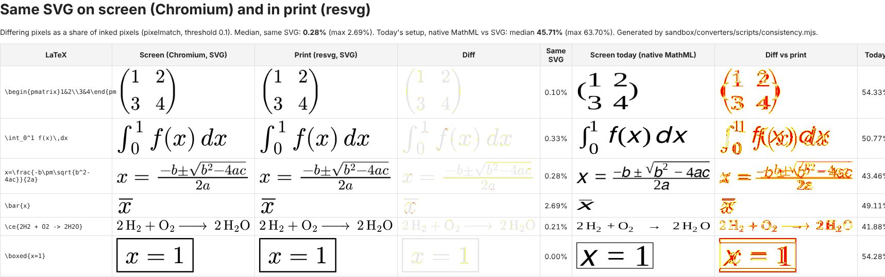

# Spike: can screen and print look the same?

**Question.** On screen, the stored MathML is drawn by the browser's math font. In print, it becomes a MathJax SVG (see [print-svg.md](print-svg.md)). The two look slightly different. Can we make them identical?

**Answer: yes. Show the same SVG on screen that goes into the PDF, and the two match up to anti-aliasing.** I measured this for all 60 corpus formulas on 2026-10-26.

| Screen vs print | Median differing pixels | Worst case |
|---|---|---|
| **Same SVG in both** (Chromium on screen, resvg for print) | **0.28%** | 2.69% (`\bar{x}`) |
| Today's split (native MathML on screen, SVG in print) | 45.7% | 63.7% |

The percentages are differing pixels as a share of inked pixels (pixelmatch, threshold 0.1, at a 48 px em). With the same SVG, the leftover differences are single edge pixels where the two rasterisers anti-alias a curve slightly differently. No glyph, position or size differs. That is the practical limit of "100% the same": two different renderers never shade edge pixels identically, and nobody can see it at reading size.

- **Evidence:** [`sandbox/converters/tests/consistency.node.test.ts`](../sandbox/converters/tests/consistency.node.test.ts) (60 tests, fails if any formula goes above 3%).
- **Every formula, with the diff images:** [`consistency.html`](consistency.html). A sample is in [`screenshots/consistency.png`](screenshots/consistency.png), and the numbers are in [`consistency-raw.json`](consistency-raw.json).
- **Script:** [`scripts/consistency.mjs`](../sandbox/converters/scripts/consistency.mjs) (`pnpm print && pnpm consistency`).

## How it was measured

For each formula, the stored Temml MathML goes through `mathmlToSvg()`. The SVG is fixed to an exact pixel size and drawn twice:

- **Screen:** inline in an HTML page in Chromium, which is what a candidate's browser does.
- **Print:** by resvg, a separate SVG renderer with no browser code, standing in for the PDF engine's SVG rasteriser.

Then the two bitmaps are pixel-diffed. (The run used Temml MathML without the LaTeX annotation. A later fix in `prepareForSvg()` makes the stored, annotated form give a byte-identical SVG, and `tests/print.node.test.ts` checks that for all 60 cases. See [insert-demo.md](insert-demo.md).) For contrast, the browser's native MathML rendering of the same formula is scaled into the same box and diffed against the print image too. Scaling it into the SVG's box is generous to native MathML on size, so the 45.7% comes from glyph shapes, font and spacing. The native column in the HTML shows it: a sans-serif font, different fences, different spacing.

## What it takes

1. **Render stored MathML with MathJax SVG on screen too,** in the QTI player and in Froala's read view, from the same stored MathML and with the same `prepareForSvg()` and MathJax version as the print path. Storage doesn't change. This is a delivery decision.
2. **Pin one MathJax version and font for both sides.** A version mismatch is the most likely way the two drift apart. The test above catches it for the print path; the player has to use the same pin.
3. **Keep the formula accessible.** An SVG on its own is a picture to a screen reader, and accessibility is a hard requirement. MathJax can keep the MathML alongside the SVG for assistive technology (its assistive MathML / speech options), or the player can keep the `<math>` element in the DOM, hidden visually. To be checked with real screen readers in M4.

## Limits

- **resvg is not XEP.** It shows that a second, independent renderer gives the same picture. The final check is one PDF from our actual engine, compared with the screen render. If the engine needs PNG, we can rasterise with resvg ourselves and the PDF would carry exactly the pixels measured here.
- **The editor still differs.** MathLive draws the formula with its own layout while someone edits it. That's authoring only. Everything a candidate sees, on screen or on paper, can come from the one SVG.
- **Only Chromium was measured on the screen side.** Inline SVG is very consistent across browsers, much more than native MathML, but Firefox and Safari belong in the M4 cross-browser check.
