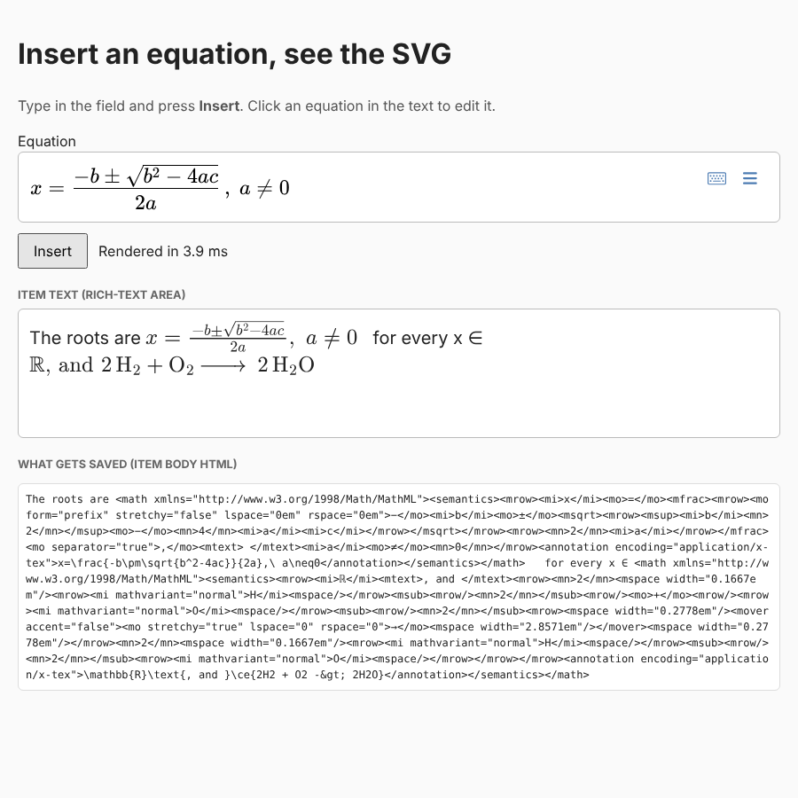

# Demo: showing an equation in the page once it's inserted

**Question.** When an author inserts an equation, how does the front end show it, and is there a built-in way?

**Answer.** MathJax has it built in: it turns MathML into SVG in the browser. We call it on the stored MathML when an equation is inserted, and when an item is loaded. Neither MathLive nor Froala renders stored math on its own. The page then shows the **same SVG as print**, so screen and paper match (see [consistency.md](consistency.md)).

- **Code:** [`src/render.ts`](../sandbox/converters/src/render.ts) (about 60 lines) and the demo page [`demo/main.ts`](../sandbox/converters/demo/main.ts).
- **Evidence:** [`tests/render.test.ts`](../sandbox/converters/tests/render.test.ts) (69 tests, Chromium) and [`scripts/demo-shot.mjs`](../sandbox/converters/scripts/demo-shot.mjs), which drives the built demo like an author: insert, insert, click to edit, update.
- **Run it:** `cd sandbox/converters && pnpm dev`.



## Flow

```
<math-field> ──Insert──► storedMathml(mf)            Temml MathML + LaTeX annotation (what we save)
                              │
                              ▼
                       renderEquation(mathml)        MathJax SVG, same code as print
                              │
                              ▼
  <span class="eq" contenteditable="false">
    <svg aria-hidden="true">…</svg>                   what sighted users see
    <math class="eq-sr">…</math>                      visually hidden, read by screen readers
  </span>
```

- **Insert** puts the equation at the caret in the rich-text area, as one unit (`contenteditable="false"`).
- **Click an equation** to load its LaTeX annotation back into the field. Insert then becomes **Update** and replaces it.
- **Saving** (`toStoredHtml()`) swaps each wrapper back to its `<math>`. The SVG is never stored; it is rebuilt on load. The output is serialised as XML, because the browser's HTML serialiser writes `&nbsp;`, which is invalid in a QTI item.
- **Screen readers:** Chromium's accessibility tree shows each equation as a `math` node with its content, for example "x = − b ± b 2 − 4 a c 2 a". Testing with NVDA, JAWS and VoiceOver belongs to M4.
- **Size:** the SVG is in `ex` units, so it scales with the surrounding text and sits on the baseline (tested at 10 px and 40 px). Rendering takes about 4 ms per equation.

## Two problems found and fixed on the way

| Problem | Effect | Fix |
|---|---|---|
| MathJax 4.1.3 draws only the first child of the `<mrow>` inside `<semantics>`, which is our stored format | `a+b` shows as `a`, and the quadratic formula as `x`. It hit **print** too: the earlier print and consistency runs used MathML without the annotation, so they didn't see it | `prepareForSvg()` now drops `<semantics>`/`<annotation>` before conversion. A print test checks that the stored format gives exactly the same SVG as before for all 60 cases, so the consistency numbers still hold |
| MathJax loads rarer glyph ranges (ℝ, fraktur, …) with a bare `import('@mathjax/…')`, which works in Node but not in a browser | `\mathbb{R}` fails ("dynamic file 'double-struck' failed to load") | [`src/mathjax-browser-fonts.ts`](../sandbox/converters/src/mathjax-browser-fonts.ts) maps each range to a lazy Vite chunk (`double-struck` is 42 KB, loaded only when used). The font package also has to stay out of Vite's dependency pre-bundling, or the ranges register on a second copy of the font |

## Cost

The display path (MathJax MathML input, SVG output and the New Computer Modern font) is **1.2 MB minified, 320 KB brotli** (`pnpm size`). MathJax ships it as one chunk. Most of it is font data (about 1 MB of source). For the QTI player, load it only on pages that contain math, or pre-render the SVG on the server when an item is saved and send only the image. The server option also takes MathJax out of the player completely.

## For M2 (Froala)

This is embedding strategy (b) in miniature: the document holds lightweight rendered equations, and a single `<math-field>` edits whichever one is clicked. The choice between (a) and (b) is still Ton's to make.
